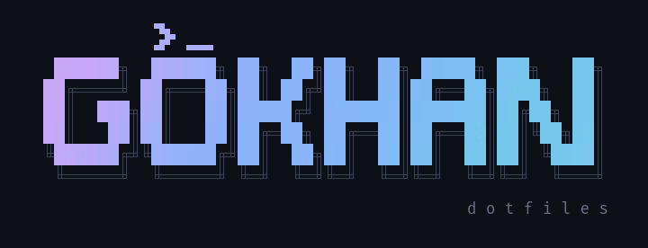

<div align="center">



<br>


</div>

```
  ┌──────────────────────────────────────────────────────────────┐
  │                                                              │
  │   $ curl -fsSL gokhanturk.com/dotfiles | sh                  │
  │                                                              │
  │   klonla  ─▶  çakışanları yedekle  ─▶  stow  ─▶  hazır ✓     │
  │                                                              │
  └──────────────────────────────────────────────────────────────┘
```

## Kurulum

```sh
curl -fsSL gokhanturk.com/dotfiles | sh                  # hepsi
curl -fsSL gokhanturk.com/dotfiles | sh -s -- fish tmux  # sadece bunlar
```

Arch, Debian ve Ubuntu'da çalışır. `git` ya da `stow` yoksa paket yöneticisiyle kurar,
repoyu `~/dotfiles`'a klonlar, yerini alacağı dosyaları `~/.dotfiles-backup/`'a taşır ve stow'lar.
Tekrar çalıştırırsan günceller.

| Değişken       | Ne yapar                                              |
| -------------- | ----------------------------------------------------- |
| `DOTFILES_DIR` | Klon yeri (varsayılan `~/dotfiles`)                   |
| `PKGS=1`       | `pkglist.txt`'deki paketleri kurar (Arch)             |
| `WALLPAPERS=1` | [Duvar kağıtlarını](https://github.com/GokhanTurk/wallpapers) `~/wallpapers`'a klonlar |

```sh
curl -fsSL gokhanturk.com/dotfiles | PKGS=1 WALLPAPERS=1 sh
```

## İçerik

| Paket       | Hedef                         |                                         |
| ----------- | ----------------------------- | --------------------------------------- |
| `alacritty` | `~/.config/alacritty`         | Terminal, FiraCode Nerd Font            |
| `bat`       | `~/.config/bat`               | `cat` yerine                            |
| `fastfetch` | `~/.config/fastfetch`         | Sistem bilgisi                          |
| `fish`      | `~/.config/fish`              | Shell, kısaltmalar, `myip`              |
| `hushlogin` | `~/.hushlogin`                | SSH girişindeki MOTD'yi sustur          |
| `nvim`      | `~/.config/nvim`              | vim.pack + catppuccin + mini.nvim       |
| `starship`  | `~/.config/starship.toml`     | Prompt                                  |
| `tmux`      | `~/.config/tmux`              | Terminal çoklayıcı                      |

Her şey Catppuccin Mocha.

## Stow nasıl çalışıyor

Her klasör bir paket. Paketin içi `$HOME`'un aynısı, stow da oraya symlink atar:

```
~/dotfiles/
└── fish/
    └── .config/
        └── fish/                         stow fish
            └── config.fish  ◀──────────────────────────  ~/.config/fish/config.fish
```

```sh
cd ~/dotfiles
stow fish          # bağla
stow -R fish       # yeniden bağla (yeni dosya eklendiyse)
stow -D fish       # kaldır
```

## Neovim

Sadece Neovim'i kurmak için (dotfiles'ın geri kalanı olmadan):

```sh
curl -fsSL gokhanturk.com/nvim | sh
```

Neovim 0.12+, plugin yöneticisi yok (dahili `vim.pack`), iki plugin var: catppuccin ve mini.nvim.
Sürümler `nvim-pack-lock.json`'da sabit. İnternet ya da git yoksa dahili tema ve netrw ile açılır.

| Tuş            | Ne yapar                         |
| -------------- | -------------------------------- |
| `Space Space`  | Dosya bul (`Ctrl-k` üst klasör)  |
| `Space fg`     | Metin ara                        |
| `Space fr`     | Son açılanlar                    |
| `Space fb`     | Açık buffer'lar                  |
| `Space e`      | Dosya gezgini                    |
| `Space w / q`  | Kaydet / kapat                   |
| `Ctrl-hjkl`    | Pencereler arası geç             |
| `J / K`        | Seçimi taşı (görsel mod)         |

`Space`'e basıp beklersen geri kalanı alt köşede çıkar.

<div align="center">
<br>
<sub>gokhanturk.com</sub>
</div>
